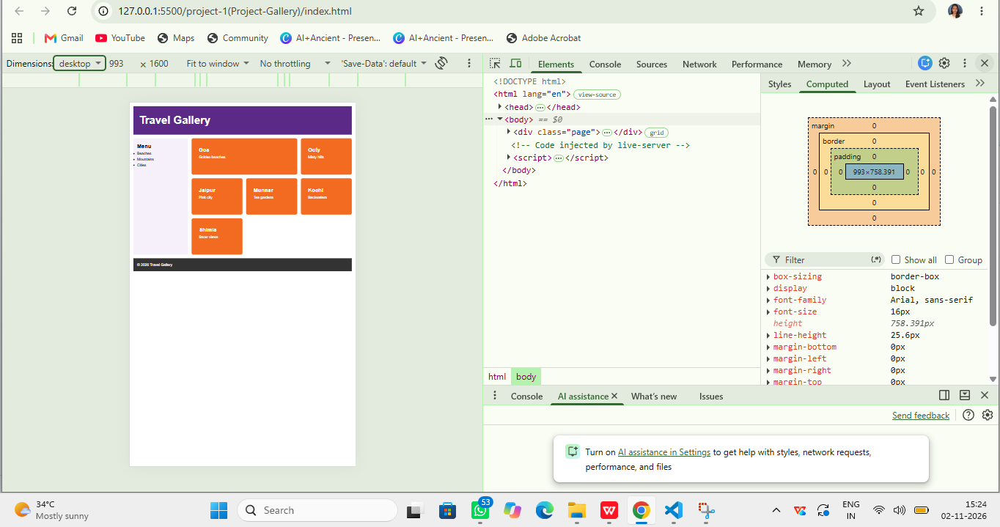
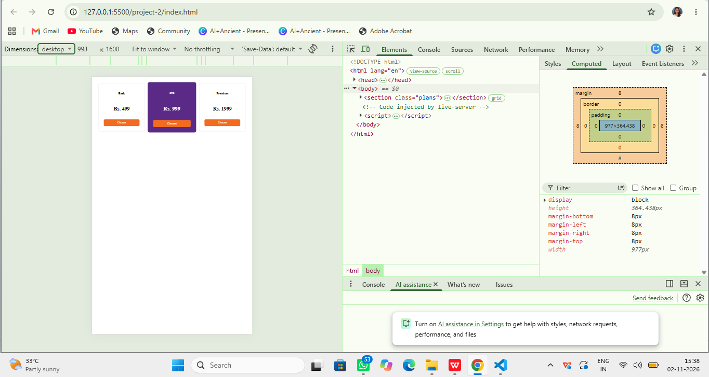
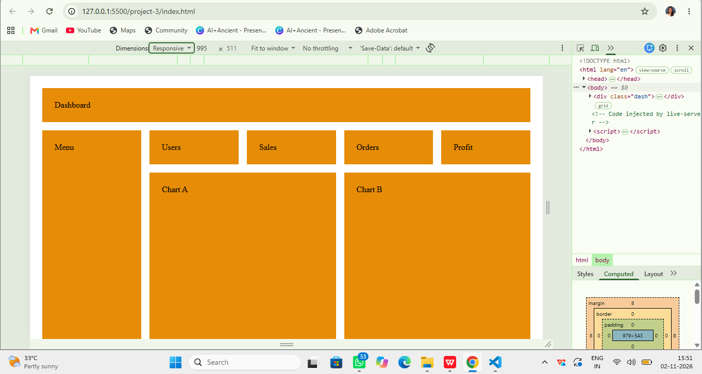

# Travel Gallery

A collection of responsive travel gallery webpages designed to showcase beautiful destinations with simple and attractive layouts.

## Screenshots

### Project 1

### Project 2

### Project 3

## Features

- Responsive webpage layouts for different screen sizes.
- Attractive travel gallery designs.
- Organized image sections.
- Simple and user-friendly navigation.
- Separate projects demonstrating different layouts.

## Technologies

- HTML5
- CSS3
- Visual Studio Code
- Git and GitHub
- Live Server extension

## How to Run

1. Clone or download this repository.
2. Open the `travel-gallery` folder in Visual Studio Code.
3. Select any project folder (`project-1`, `project-2`, or `project-3`).
4. Open its `index.html` file.
5. Right-click and select **Open with Live Server**.
6. View the webpage in your browser.

## Author / Contact

**SK Akshaya**

GitHub: https://github.com/sk-akshaya
